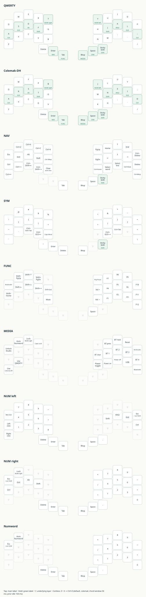

# Bykeeb ZMK configuration

36-key split with switchable QWERTY and Colemak-DH for two Seeed XIAO nRF52840
controllers, with upstream ZMK, Studio support, positional home-row modifiers,
opposite-hand layers, sticky Shift and optional numeric modes.



Download and open [the interactive layer reference](docs/layout.html) in a browser,
or zoom and print [the SVG](keymap-drawer/bykeeb.svg). Display geometry follows
the previous diagram's approximation; matrix wiring and key ordering are unchanged.

## Build and flash

1. Open **Actions → Build firmware** and select the run for your branch/commit.
2. Wait for both halves to succeed, then download the `firmware` artifact.
3. Extract `bykeeb_left.uf2` and `bykeeb_right.uf2`.
4. Connect one half by USB and double-press its physical RESET button.
5. Copy that half's matching UF2 to its bootloader drive.
6. Repeat for the other half. Update **both halves** together for this migration.

Save your old working firmware before upgrading. Roll back by flashing the old
matching pair. This repository does not contain your previously flashed binaries;
old source alone cannot reconstruct dependencies that used moving branches.

If Bluetooth fails, remove the host pairing, clear the relevant keyboard profile
and pair again. If the halves no longer connect, follow
[ZMK connection troubleshooting](https://zmk.dev/docs/troubleshooting/connection-issues).
Settings-reset firmware is a recovery step, not part of a normal upgrade.
The artifact also includes `recovery_settings_reset.uf2`. Flash it only when a
settings reset is needed, then immediately reflash the normal matching firmware.
It clears saved settings and Bluetooth bonds on whichever half receives it.

## Your layout

QWERTY is selected at startup. To switch layouts, hold Backspace for about half a
second to activate MEDIA, then tap:

- **Z → Colemak-DH**
- **X → QWERTY**

Z and X have the same physical positions in both layouts. Switching takes effect
immediately and lasts until the next switch or restart; it does not require
reflashing. Keep your computer's input layout set to **US**: the keyboard sends
the chosen letter layout itself.

The Colemak-DH base uses the official
[matrix/ergonomic layout](https://colemakmods.github.io/mod-dh/keyboards.html):

```text
Q W F P B    J L U Y ;
A R S T G    M N E I O
Z X C D V    K H , . /
```

Tap for the main legend; hold for the second action.
Thumbs, left to right: Delete, Enter/NAV, Tab/FUNC, Backspace/MEDIA, Space/SYM,
sticky Shift. Hold Space/SYM and tap **Z for quote**, or the **leftmost thumb
(Delete position) for double quote**. Both are opposite the layer-holding thumb.
Caps Lock has moved to MEDIA + the R / Colemak P position; Caps Word stays on SYM + G.

The number-layer holds stay on the top inner letter of each half, but now operate
the **opposite** hand: hold T (QWERTY) / B (Colemak-DH) for the right numpad;
hold Y / J for the left numpad. These letter holds use positional roll protection,
with the same 280/150/175 ms settings as the home-row mods. After fast typing,
pause briefly before starting a number-layer hold. The MEDIA shortcuts below
also enter numeric modes without occupying a finger during number entry.

Home-row modifiers also stay on the same fingers:

| Layout | Left pinky | Left ring | Left middle | Left index | Right index | Right middle | Right ring | Right pinky |
|---|---|---|---|---|---|---|---|---|
| Hold | Ctrl | GUI | Alt | Shift | Shift | Right Alt/AltGr | GUI | Ctrl |
| QWERTY tap | A | S | D | F | J | K | L | ; |
| Colemak-DH tap | A | R | S | T | N | E | I | O |

On MEDIA, **Q unlocks Studio**. Bluetooth clearing is still MEDIA + the right
half's leftmost home-row key (H in QWERTY, M in Colemak-DH).
Z + X Undo works on both base layouts
and requires 150 ms prior idle to reduce accidental activation during typing.
Colemak-DH moves V to the old B position, so Ctrl+V moves with it.

After flashing this update, if you have previously saved mappings in Studio,
record any edits you want to keep and choose **Restore Stock Settings** in Studio
to load the new **nine-layer mapping**. This revision changes NAV and numeric
bindings, changes the quote thumb to Shift, and adds a separate Numword layer.
This restores the keymap, without requiring settings-reset recovery firmware.

## Numbers without same-hand holds

| Action | Shortcut | Result |
|---|---|---|
| Brief right-hand number entry | Hold T / Colemak B | Right numpad, plain left modifiers |
| Brief left-hand number entry | Hold Y / Colemak J | Left numpad, plain right modifiers and existing mouse buttons |
| Lock right numpad directly | Hold Backspace/MEDIA, tap **E / Colemak F**, release both | Type numbers without holding a key |
| Lock after a right-numpad hold | Hold T / Colemak B, tap **W**, release both | The numpad stays on |
| Unlock right numpad | Tap **W** on the locked numpad | Letters return, without sending an application key |
| Start Numword | Hold Backspace/MEDIA, tap **W**, release both | Right numpad that exits automatically |
| Stop Numword explicitly | Tap **W** on Numword | Letters return, without sending an application key |

There are no numeric thumb combos: typing a newline followed by spaces, or a tab
followed by a space, does not switch modes. The W key locks the right numpad when
it was activated by a letter hold, then unlocks it on the next press. Releasing
the original letter hold does not undo the lock. While that hold remains pressed,
unlocking also disables the layer; release and re-hold the letter to reactivate it.

The right numpad is:

```text
* 7 8 9 -
/ 4 5 6 +
= 1 2 3 0
```

Numeric thumbs are plain Delete, Enter, Tab, Backspace, Space and decimal point,
so holding Backspace repeats. Enter confirms normally, without entering NAV.

Numword continues on digits, Backspace, Delete and arithmetic punctuation.
Space, Enter, Tab or other non-continuation keys exit it **and still reach the
application**. The left half remains available for letters; a right-hand letter
at a numpad position still produces a number. For example, to type `12h` in
Colemak, cancel Numword before H, or H's physical key will produce `1`.
W cancels Numword without sending any application key. To type a literal W while
in Numword, tap W to exit, then W again for the letter.

Numeric mode entry lives on MEDIA, while numeric Backspace is a plain key, so
exit the current mode before entering the other. The number layers expose
**Esc / exit NUM** on the unused top pinky: Q position for right numpad/Numword,
P position for left numpad. It sends Escape, cancels auto-mode and clears numeric
locks without changing your selected base. Escape can also cancel an application
operation (for instance, leave Vim insert mode); use W to exit a right-hand lock
or Numword without sending Escape.

## Navigation and editing

Hold **Enter** with your left thumb. The arrows are now on the **right** hand:
Up on the middle finger's top row; Left/Down/Right on index/middle/ring home row.
Home/End sit beside Up, Page Up/Down on the inner column, Delete on the pinky.
The left home row is plain Ctrl/GUI/Alt/Shift in the same modifier positions as
the base. Hold the layer first to use these direct modifiers; the base HRMs also
continue to work if held before entering NAV. The thumb hold itself still uses
the ordinary 200 ms layer-tap threshold.

| Editing action | NAV position (QWERTY / Colemak-DH) |
|---|---|
| Undo, cut, copy, paste | W, E/F, R/P, T/B |
| Delete previous word | G or / |
| Delete next word | P / ; |
| Previous/next word | Z / X |
| Select previous/next word boundary | C / V (Colemak C / D) |
| Select current word | M / H |
| Select current line | comma |
| Clear current terminal input line | B / V |
| Start/end of document | N / K and dot |

Word selection sends Ctrl+Right, Ctrl+Left, Ctrl+Shift+Right each time; it does
not implement Getreuer's stateful extension across successive words. Line
selection sends Home, Shift+End. These assume conventional Linux/Windows editor
shortcuts. Terminal/Codex inputs often interpret these keys differently and do
not provide GUI-style highlighting. **Clear current terminal input line** sends
Ctrl+E, Ctrl+U for readline-style inputs (one logical line, not an entire
multiline prompt); use it without other modifiers held. It sends no Enter.
The host shortcut sequences use 40 ms taps and waits, following
[ZMK's BLE pacing guidance](https://zmk.dev/docs/keymaps/behaviors/macros#keycode-sequences).
Numeric Escape exits disable the layers immediately, then send a 40 ms Escape
tap to clear Numword bookkeeping and notify the application.

## Sticky Shift and Backspace repetition

The rightmost thumb now has a dedicated sticky Shift, without tap-hold timing:
tap and release, then type a capital; or hold it while typing for ordinary Shift.
An unused tap expires after 1500 ms. Quick release prevents it from capitalizing
a following rolled key. Existing Shift HRMs remain for multi-modifier shortcuts.
Caps Word is still **Space/SYM + G** for identifiers such as `MY_CONSTANT`.

Backspace still holds MEDIA after 200 ms. To repeat deletion, **tap Backspace,
then quickly press and hold it again**, starting the second press within 200 ms
of the first press. During that window the second press cannot activate MEDIA;
pause before entering MEDIA immediately after a deletion. This repeat setting
is local to Backspace, not applied to Enter, Tab or Space. NAV, SYM and numeric
layers also provide a plain repeating Backspace.

## Home-row modifier tuning

The `hml` and `hmr` behaviors use the upstream-supported
[timeless approach](https://zmk.dev/docs/keymaps/behaviors/hold-tap#custom-hold-tap-examples):

- `balanced` recognizes a chord when the target key is pressed and released.
- Opposite-hand keys and all thumbs can trigger early modifier chords.
- `hold-trigger-on-release` permits stacking held modifiers on the same hand.
- `tapping-term-ms = <280>` retains deliberate same-hand shortcuts after a hold.
- `require-prior-idle-ms = <150>` makes home-row presses during typing become letters.
- `quick-tap-ms = <175>` supports tap-then-hold letter repetition.

For Copy, hold right Ctrl (`;` in QWERTY, O in Colemak-DH) and tap C. After typing a word, pause briefly
before starting a modifier chord. For a same-hand shortcut, first hold the modifier
past 280 ms.

Edit both behaviors in
[`boards/shields/bykeeb/bykeeb.keymap`](boards/shields/bykeeb/bykeeb.keymap):

| Symptom | First adjustment |
|---|---|
| Cross-hand typing produces modifiers | Increase prior idle in small steps |
| Shortcuts become letters just after typing | Decrease prior idle |
| Same-hand shortcuts feel slow | Decrease tapping term cautiously |
| Mid-word Shift is missed | Give Shift a separate behavior with less prior idle, or consider dedicated/sticky thumb Shift |

These defaults need real typing validation. Shift HRMs have the same protection as
other modifiers; use the dedicated sticky thumb Shift for fast capitals.
Mouse modifier clicks require waiting for the hold threshold; eager modifiers
(`hold-while-undecided`) are not enabled.

## ZMK Studio

1. Connect the **left half** by USB. If needed, select USB output by holding
   Backspace/MEDIA and pressing the key at the `.` position.
2. Open [ZMK Studio](https://zmk.studio/) in Chrome/Edge or its native app.
3. Hold **Backspace/MEDIA and press Q** to unlock, then connect and edit bindings.

Studio can assign built-in behaviors and the compiled `Home Row Left` and
`Home Row Right` behaviors. USB Studio is enabled on the central/left half only.
The upstream defaults also enable BLE Studio on the central half. Use the native
Studio app for BLE editing on Windows/macOS; Linux also supports BLE in the web
app. Ordinary Bluetooth keyboard use is retained.

Timings, new behaviors and combos require source edits and a rebuild.
Studio mappings persist on the keyboard: after changing mappings in source and
flashing, use **Restore Stock Settings** to load compiled defaults. Record wanted
Studio edits first, because restoring replaces the saved mapping.
Diagrams show firmware defaults, not runtime Studio changes.

## Editing and layout references

The only firmware keymap is `boards/shields/bykeeb/bykeeb.keymap`.
Display geometry is in `boards/shields/bykeeb/bykeeb-layouts.dtsi`.
After editing either, run:

```sh
python3 scripts/render_keymap.py
python3 scripts/render_keymap.py --check
```

This generates the SVG, interactive HTML and JSON-compatible YAML directly from
the firmware keymap using only Python's standard library. Layout CI rejects stale
diagrams. Add parser/label support when introducing a new behavior.
The renderer checks each 36-key layer and its index; it does not replace a firmware build.
Both bases precede the seven shared layers so NAV, SYM and other layers override
the selected base, with transparent keys falling through to that base.

## Firmware dependencies

`config/west.yml` pins upstream ZMK to
`4dd95d7840eb3d5a3f59bb29fbf1ab054715ef85` (2026-10-09) and Zephyr to
`10ba6d0cb38bc3d258775d27982f707599320085`.
This is a development snapshot, not a claim that v0.4 has been released.
The build workflow uses the same ZMK revision; imported modules use the revisions
in those pinned manifests. Numword uses
[`urob/zmk-auto-layer`](https://github.com/urob/zmk-auto-layer) pinned to
`b50d514219c5ad61198f9a8be137c59d0674b11c`. Basic numeric locking, sticky Shift,
hold-taps and editing macros use upstream ZMK behaviors. The auto-layer behavior
is invoked by compiled bindings; its properties are configured in source.

The old pointer fork, chiptuner and Fingerpunch dependencies are removed. This
shield uses ordinary GPIO matrix scanning and upstream mouse buttons; no attached
trackpad or trackball is defined. `CONFIG_ZMK_POINTING=y` enables upstream pointing.
The new `xiao_ble//zmk` target includes upstream battery sensing and bootloader
support. The original 30-minute deep sleep remains in `config/bykeeb.conf`.

Future upgrades should deliberately update the ZMK/Zephyr pins and matching
workflow revision, then build both halves and check the layout references.

## Validate this revision on the keyboard

After the builds pass, flash both halves and restore stock mappings if Studio
has saved edits. Check both bases, then:

1. Hold the top inner left letter, type right-hand digits, release: letters return.
   Repeat with the right hold and left digits. Check fast rolls of the base letters.
2. MEDIA + E / Colemak F: release both, type digits, tap W: letters return.
   Also lock with W while the letter hold is down, then release it: digits remain.
3. MEDIA + W: type `123.45`, Space, then letters: automatic exit. Repeat with
   Enter and Tab. Check manual cancellation before a right-hand letter.
4. Exit numeric modes with Escape and confirm Colemak stays selected. Check
   numeric entry requires leaving the current mode first.
5. Hold Enter, then plain Ctrl/Shift and right arrows; test word/line selection
   in an editor and clear-line in a disposable terminal input without executing it.
6. Tap Shift then roll two letters: only the first should be capitalized. Hold
   Shift for multiple capitals; leave an unused tap idle past its timeout.
7. Tap-then-hold Backspace: deletion repeats. A normal hold still accesses MEDIA.
   Check Studio unlock, Bluetooth profile selection and QWERTY/Colemak switching.

Firmware compilation and the reference regression tests do not substitute for
these physical typing checks. The newly built pair is a candidate for testing.

## Related configurations reviewed

- [Getreuer's HRM article](https://getreuer.info/posts/keyboards/hrms-are-hard/index.html)
  supports the retained balanced/positional configuration and a separate Shift.
  [His keymap](https://github.com/getreuer/qmk-keymap) inspired layer locking,
  direct navigation modifiers and editing macros; its Magic Sturdy base is not used.
- [Miryoku](https://github.com/manna-harbour/miryoku/tree/master/docs/reference)
  motivates opposite-hand layer access and plain modifiers on the holding side.
- [urob's config](https://github.com/urob/zmk-config) explains timeless HRMs and
  Numword's benefits and limitations. Only the auto-layer module is added here.

- [Vianney's Bykeeb config](https://github.com/vianneyrenata/zmk-config-bykeeb)
  demonstrates upstream pointing, dedicated thumb Shift and a recovery build.
  Its active layout does not use its declared home-row mod behaviors. The recovery
  image idea is retained here; its different layout and optional RGB are not copied.
- [Fingerpunch's example](https://github.com/sadekbaroudi/zmk-config-fp-example)
  and its migration guide explain controller renames, per-board filenames, pinned
  upstream revisions and Cirque input processors. This Bykeeb defines no Cirque
  or VIK device, so those extra hardware modules are not required.

